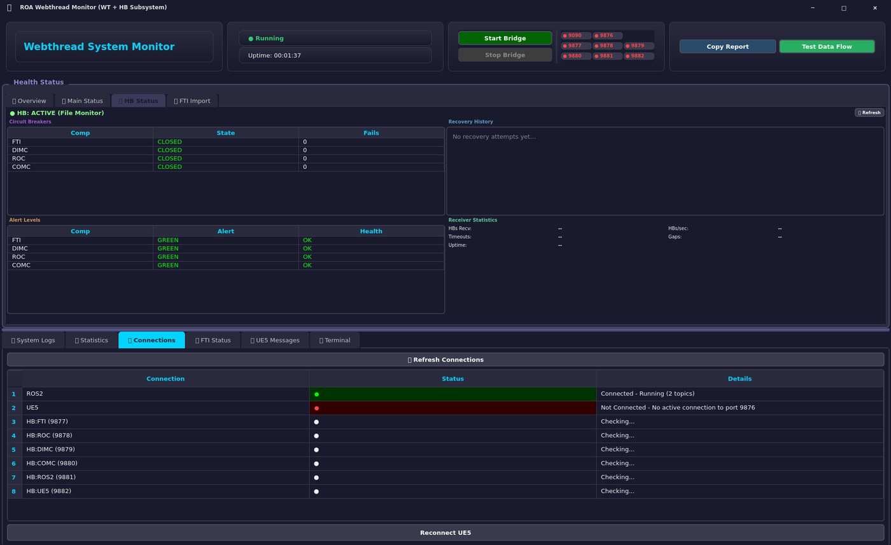
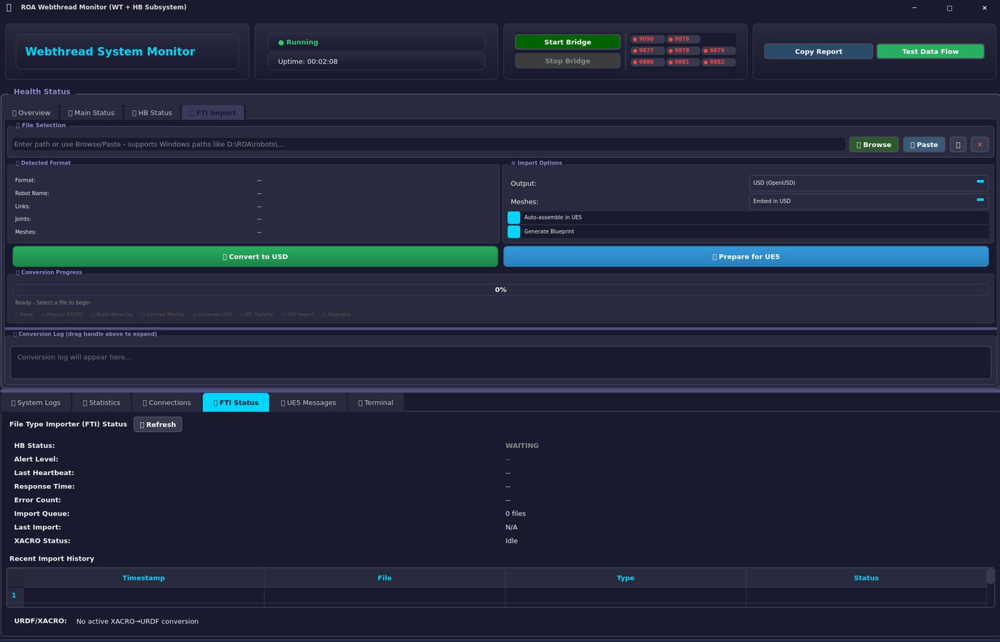
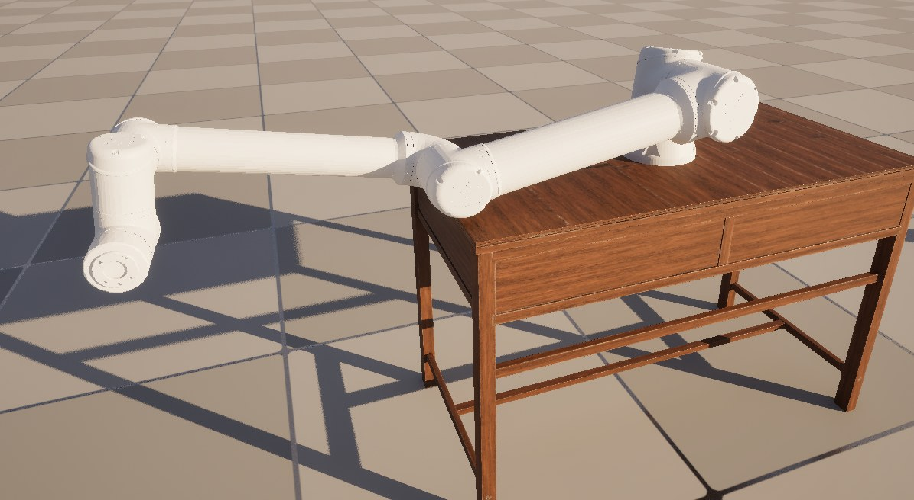

# 🤖 ROA - Robot Operator Assistant

[](https://opensource.org/licenses/MIT)
[](https://www.unrealengine.com/)
[](https://docs.ros.org/en/humble/)
[](https://python.org/)

**ROA bridges ROS2/Gazebo simulation with Unreal Engine 5 for real-time robot control and visualization in construction scenarios.**

---

## 📋 Overview

ROA (Robot Operator Assistant) is a cross-platform robotics simulation and control system:

- **Linux/WSL2**: ROS2 services, URDF→USD conversion, robot coordination
- **Windows/UE5**: Real-time 3D visualization, physics simulation, operator UI

### Architecture

```
┌────────────────────────────────────────────────┐
│         WEBTHREAD (Central Coordinator)        │
│    ROS2 ↔ UE5 Bridge + Health Monitoring      │
└──────────┬─────────────┬──────────┬────────────┘
           ↓             ↓          ↓            ↓
      ┌───────┐     ┌───────┐  ┌──────┐    ┌──────┐
      │  FTI  │     │ DIMC  │  │ ROC  │    │ COMC │
      │3D Imp │     │Spatial│  │Ctrl  │    │Multi │
      │  ✅  │     │  📋   │  │ 📋  │    │ 📋   │
      └───────┘     └───────┘  └──────┘    └──────┘
```

**Components:**
- **FTI** (Files Type Importer): ✅ Production - URDF/XACRO→USD conversion
- **DIMC** (Dimensions Collector): 📋 Planned - Spatial tracking, obstacle detection
- **ROC** (Robot Controller): 📋 Planned - Manual + strategic control modes
- **COMC** (Communication Center): 📋 Planned - Multi-robot coordination

### Visual Overview

| WSL Webthread Monitor & ROS2 Heartbeat Supervision | WSL Files Type Importer (FTI) — OpenUSD Converter | UE5.6 Verified UR10e Assembly |
|---|---|---|
|  |  |  |
| *Fault-tolerant supervision: active ROS2 topics, microservice circuit breakers, and monitored IPC ports.* | *Windows-to-WSL path ingestion converting URDF/XACRO/CAD models into OpenUSD & UE5 Blueprints.* | *Automated URDF → OpenUSD → Unreal Engine 5.6 import with gravity-stable joint constraints.* |

---

## 📁 Repository Structure

```
ROA/
├── roa-linux/                    # Linux core application
│   ├── roa-core/                 # Main application
│   │   ├── bin/                  # Entry scripts (roa, roa.bat)
│   │   ├── config/               # Configuration files
│   │   └── lib/                  # Core libraries
│   │       ├── components/       # Microservices
│   │       │   ├── files-type-importer/    # ✅ FTI (production)
│   │       │   ├── dimensions-collector/   # 📋 DIMC
│   │       │   ├── robot-operator-controller/ # 📋 ROC
│   │       │   ├── communication-center/   # 📋 COMC
│   │       │   └── webthread/              # Central coordinator
│   │       └── ui/               # NiceGUI dashboard
│   ├── config/                   # System configuration
│   │   └── observability/        # Grafana, Prometheus, Loki stack
│   └── docs/                     # Architecture documentation
│       ├── SIMILAR_PROJECTS_RESEARCH.md  # 12+ projects analyzed
│       └── ...
│
├── ue5-plugin/                   # Unreal Engine 5 Plugin
│   ├── Source/ROA/               # C++ plugin source
│   │   ├── Public/               # Headers
│   │   └── Private/              # Implementation
│   ├── Resources/Python/         # Python integration scripts
│   ├── Blueprints/               # UE5 Blueprint assets
│   ├── Content/                  # Plugin content
│   └── ThirdParty/               # Fast-DDS, rclcpp integration
│       └── INTEGRATION_GUIDE.md
│
├── robot-models/                 # 3D robot models (1GB)
│   └── ROBOT_MODELS_CATALOG.md
│
└── docs/                         # Shared documentation & thesis
    ├── images/                   # System & simulation screenshots
    └── Thesis/
        └── ROA_EN_V5.pdf         # Passed B.Sc. Thesis (81 pages)
```

---

## 🚀 Quick Start

### Prerequisites

**Linux/WSL2:**
- Ubuntu 22.04+
- Python 3.10+
- ROS2 Humble (optional - for full ROS integration)

**Windows:**
- Unreal Engine 5.6+
- Visual Studio 2022 (for plugin compilation)

### Installation

#### 1. Linux Core (Required)

```bash
cd roa-linux
chmod +x install.sh
./install.sh          # Installs to /opt/roa

# Verify installation
roa --version         # Should show: ROA v0.2.0-alpha
```

#### 2. UE5 Plugin (Required)

**Copy plugin to your UE5 project:**
```powershell
# Windows PowerShell
Copy-Item -Recurse ue5-plugin/* "D:\YourProject\Plugins\ROA_PlugIn\"
```

**Set up dependencies:**
```powershell
cd D:\YourProject\Plugins\ROA_PlugIn\ThirdParty
.\setup_bundled_python.ps1  # Installs Python + xacro

# For native ROS2 (optional, advanced):
# Follow ThirdParty/INTEGRATION_GUIDE.md
```

**Enable in UE5:**
1. Open your UE5 project
2. Edit → Plugins → Search "ROA"
3. Enable "ROA - Robot Operator Assistant"
4. Enable "Python Script Plugin" (dependency)
5. Restart editor

#### 3. Robot Models (Optional)

```bash
# Download pre-configured robot models
cd robot-models
./download_robot_models.sh  # Downloads TurtleBot3, UR5, etc.
```

### Verify Installation

```bash
# Test 1: Linux services
roa --help

# Test 2: UE5 connection
cd roa-linux
./test_ue5_connection.sh  # Should show: ✅ Connection successful

# Test 3: Convert a robot
roa convert \
  --input robot-models/turtlebot3/turtlebot3_burger.urdf \
  --output ~/test_output/ \
  --name test_robot
# Should create: test_robot_assembled.usd
```

**Next:** See [Usage](#-usage) section for full workflow examples.

---

## 🎮 Usage

### Linux Side: Robot Conversion & Services

**1. Convert robot URDF to UE5 format:**

```bash
# Navigate to FTI component
cd /opt/roa/lib/components/files-type-importer

# Convert URDF to USD (UE5-compatible format)
python src/python/robot_converter.py \
  --input /path/to/robot.urdf \
  --output /path/to/output/ \
  --robot-name my_robot

# Outputs:
# - my_robot_assembled.usd (UE5 imports this)
# - my_robot_hierarchy.json (joint/link metadata)
```

**2. Start ROA services:**

```bash
# Launch main ROA application
roa start

# Or start individual components:
cd /opt/roa/lib/components/files-type-importer
python src/python/roa_ipc_service.py  # FTI service on port 5555
```

**3. Dashboard (optional):**

```bash
roa dashboard  # Opens web UI at http://localhost:8080
```

### UE5 Side: Robot Simulation

**1. Enable ROA Plugin:**
   - Open your UE5 project
   - Edit → Plugins → Search "ROA"
   - Enable "ROA - Robot Operator Assistant"
   - Restart editor

**2. Import converted robot:**
   - Content Browser → Right-click → Import
   - Select `my_robot_assembled.usd`
   - ROA auto-creates Blueprint with physics constraints

**3. Spawn robot in scene:**
   - Drag Blueprint from Content Browser to viewport
   - Or use Widget: `ROA Tools → Robot Spawn Dialog`

**4. Control robot:**

**Blueprint (Visual Scripting):**
```
Event Tick
  ↓
Get Actor Constraint Names (Target: RobotActor)
  ↓
Set Constraint Target Angle
  - Constraint Name: "joint_1"
  - Target Angle: 45.0
  - Angular Velocity Limit: 1.0
```

**Python (Unreal Python API):**
```python
import unreal

# Get ROA utilities
utils = unreal.ROABlueprintUtils

# Find robot actor
robot = unreal.EditorLevelLibrary.get_all_level_actors()[0]

# Get available joints
joints = utils.get_actor_constraint_names(robot)
print(f"Robot joints: {joints}")

# Control joint
utils.set_constraint_target_angle(robot, "shoulder_joint", 90.0)
utils.set_constraint_target_velocity(robot, "elbow_joint", 2.0)

# Emergency stop
utils.emergency_stop_actor_joints(robot)
```

**5. Test connection (verify Linux ↔ UE5 bridge):**

```bash
# From project root
python test_ue5_connection.sh
# Expected: "✅ Connection successful"
```

### Full Workflow Example

```bash
# === LINUX TERMINAL ===
# 1. Convert TurtleBot3 URDF
cd /opt/roa
roa convert \
  --input robot-models/turtlebot3/turtlebot3_burger.urdf \
  --output ~/ue5_robots/ \
  --name turtlebot3

# 2. Start services
roa start

# === UE5 EDITOR (Windows) ===
# 3. Import robot
#    - File → Import → ~/ue5_robots/turtlebot3_assembled.usd
#    - Blueprint auto-created: BP_TurtleBot3

# 4. Place in scene
#    - Drag BP_TurtleBot3 to viewport

# 5. Control via Blueprint or Python
#    - See examples above
```

For detailed guides, see:
- **Linux usage:** [roa-linux/docs/](roa-linux/docs/)
- **UE5 usage:** [ue5-plugin/Guides/INDEX.md](ue5-plugin/Guides/INDEX.md)
- **Quick test:** [ue5-plugin/Guides/QUICK_TEST_GUIDE.md](ue5-plugin/Guides/QUICK_TEST_GUIDE.md)

---

## 🔧 Development

### FTI (Files Type Importer) - Production Ready

Convert robot descriptions to UE5-compatible USD:

```python
from Converters.urdf_converter import URDFConverter

converter = URDFConverter()
result = converter.convert(
    input_path="robot.urdf",
    output_path="output/",
    robot_name="my_robot"
)
# Outputs: my_robot_assembled.usd, my_robot_hierarchy.json
```

**Tests:**
```bash
cd roa-linux/roa-core/lib/components/files-type-importer
python -m pytest tests/ -v  # 30+ tests, 80%+ coverage
```

### UE5 Plugin Development

**Key modules in `Resources/Python/`:**
- `robot_blueprint_factory.py` - Creates robot Blueprints from USD
- `physics_constraint_setup.py` - Physics configuration
- `ue5_hierarchy_assembler.py` - Actor hierarchy building

**C++ source in `Source/ROA/`:**
- `ROABlueprintUtils` - Blueprint manipulation utilities
- `ROANetworkServer` - Command server (port 9876)
- `ROARobotActor` - Robot actor base class
- `ROARobotControlPanel` - UI widgets

**Rebuild plugin (Windows PowerShell):**
```powershell
cd <YOUR_UE5_PROJECT_PATH>
.\rebuild_plugin.ps1
```

---

## 📖 Documentation

| Document | Description |
|----------|-------------|
| [DEPENDENCIES.md](DEPENDENCIES.md) | All external projects, plugins, and libraries |
| [SIMILAR_PROJECTS_RESEARCH.md](roa-linux/docs/SIMILAR_PROJECTS_RESEARCH.md) | Research on 12+ robotics projects |
| [roa-linux/docs/ARCHITECTURE.md](roa-linux/docs/ARCHITECTURE.md) | System architecture deep-dive |
| [B.Sc. Thesis (ROA_EN_V5.pdf)](docs/Thesis/ROA_EN_V5.pdf) | Full 81-page system architecture, closed-loop control analysis & design trade-offs |
| [ue5-plugin/Guides/INDEX.md](ue5-plugin/Guides/INDEX.md) | UE5 plugin documentation |
| [roa-linux/docs/](roa-linux/docs/) | Component requirements & guides |

---

## 🤝 Contributing

1. Fork the repository
2. Create a feature branch (`git checkout -b feature/amazing-feature`)
3. Follow the component development pattern (see FTI for reference)
4. Ensure 80%+ test coverage
5. Submit a Pull Request

### Component Development Checklist

New components should follow this structure:
```
components/{component_name}/
├── README.md                      # Overview, API docs
├── src/python/                    # Implementation
├── tests/                         # Unit + integration tests
├── Config/                        # Configuration
└── INTEGRATION_GUIDE.md           # ROS2 topics, dependencies
```

---

## 📄 License

This project is licensed under the MIT License - see [LICENSE](LICENSE) file.

---

## 🙏 Acknowledgments

- **Open-source robotics community** - ROS2, MoveIt, Nav2, Gazebo, and 12+ projects analyzed (see [DEPENDENCIES.md](DEPENDENCIES.md))
- **[eProsima](https://www.eprosima.com/)** - Fast-DDS for high-performance DDS communication
- **[Pixar Animation Studios](https://graphics.pixar.com/)** - Universal Scene Description (USD)
- **[Universal Robots](https://www.universal-robots.com/)** - UR robot models for testing
- **[Epic Games](https://www.unrealengine.com/)** - Unreal Engine 5
- **[Open Robotics](https://www.openrobotics.org/)** - ROS2

For complete attribution, see [SIMILAR_PROJECTS_RESEARCH.md](roa-linux/docs/SIMILAR_PROJECTS_RESEARCH.md).

---

**Questions?** Open an issue or see the [documentation](docs/).
